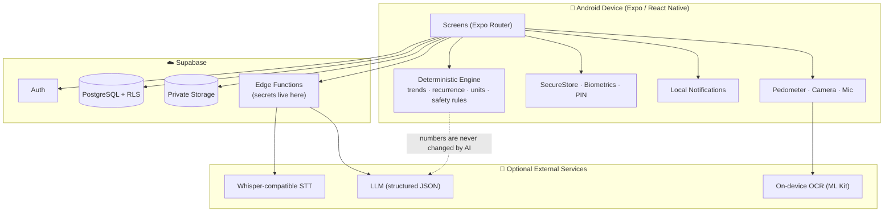

<div align="center">

# 🌿 HerHealth

### A privacy-first health companion that makes sure small symptoms are never forgotten before the doctor's visit.

**recHERsion'26 · Problem Statement 1: Women's Healthcare**

[🎥 Demo Video](FILL_LINK) · [📱 Download APK](FILL_LINK) · [📊 Pitch Deck](FILL_LINK) · [🌐 Live Backend](FILL_LINK)

`React Native` · `Expo` · `TypeScript` · `Supabase (Postgres + RLS)` · `Whisper STT` · `OCR` · `LLM (structured output)`

</div>

---

## ⚡ 30-Second Pitch

Women often reach a consultation unable to recall *when* a headache started, *how often* the fatigue came back, or what last month's lab value was. HerHealth turns scattered everyday signals (symptoms, cycles, glucose, BP, sleep, lab reports, medicines) into one private timeline, and then into a **doctor-ready summary**.

It is **not a period tracker and not a medical chatbot.** It never diagnoses or prescribes. Every number comes from deterministic code. AI only helps with *organizing and phrasing* what the user has recorded.

---

## 📑 Table of Contents

1. [The Problem](#-the-problem)
2. [Target Users](#-target-users)
3. [Our Solution](#-our-solution)
4. [What Makes HerHealth Different](#-what-makes-herhealth-different)
5. [Demo Scenario (End-to-End Workflow)](#-demo-scenario-end-to-end-workflow)
6. [Feature Status](#-feature-status-honest)
7. [Architecture](#-architecture)
8. [Tech Stack](#-tech-stack)
9. [Safety and Ethics](#-safety-and-ethics-by-design)
10. [Privacy and Security](#-privacy-and-security)
11. [Database Design](#-database-design)
12. [Testing](#-testing)
13. [Getting Started](#-getting-started)
14. [Building an APK](#-building-an-android-apk)
15. [Feasibility, Impact and Roadmap](#-feasibility-impact-and-roadmap)
16. [UX and Accessibility](#-ux-and-accessibility)
17. [Mapping to Evaluation Criteria](#-mapping-to-the-evaluation-criteria)
18. [Known Limitations](#-known-limitations)
19. [Team](#-team)
20. [Disclaimer](#-medical-disclaimer)

---

## 🎯 The Problem

The problem statement asks for solutions to *gaps in diagnosis, symptom tracking, health awareness, or access to meaningful clinical insights.*

We focused on the gap that sits **before** the clinic:

| Gap | What happens today |
|---|---|
| **Forgotten symptoms** | Minor, recurring symptoms (headache, fatigue, dizziness) are dismissed or forgotten, so patterns never reach a clinician. |
| **Fragmented records** | Lab reports are paper or photos, medicines are in WhatsApp chats, readings are in notebooks. |
| **Short consultations** | Patients struggle to give an accurate history in a few minutes. |
| **Language barrier** | Most tools assume typed, formal English. Many users think and speak in Hindi or Hinglish. |
| **Privacy fear** | Women's health data (cycles, reproductive history) is deeply sensitive; many apps are unclear on who sees it. |

> 📌 *FILL: add 1–2 verifiable statistics with citations (WHO, ICMR, NFHS, etc.) here. Only use numbers you can source.*

---

## 👩 Target Users

- **Everyday user**: no diagnosis, wants to notice recurring symptoms and cycle patterns.
- **User with a chronic condition** (diabetes, thyroid, hypertension, PCOS): needs readings, reports and medicines in one place.
- **Caregiver-supported or less tech-comfortable user**: benefits from voice logging in Hindi / Hinglish.

---

## 💡 Our Solution

HerHealth is an Android-first mobile app with five areas:

| Tab | Purpose |
|---|---|
| 🏠 **Home** | Daily check-in, personalized shortcuts, today's overview, recent patterns |
| 📓 **Health Log** | Symptom journal, measurements (glucose, BP, weight…), sleep, activity, cycle |
| 📄 **Reports** | Private document vault, OCR, lab trends, monthly report |
| 🩺 **Care** | Medicines, reminders, appointments, doctor-ready summary |
| 👤 **Profile** | Privacy lock, preferences, consent, export, delete account |

The dashboard **adapts to the onboarding profile**: a user tracking diabetes sees glucose logging; a user who enables cycle tracking sees the cycle widget; everyone gets the symptom journal.

---

## 🌟 What Makes HerHealth Different

1. **Pre-consultation focus.** Everything is built toward one outcome: *a clear, accurate, doctor-ready summary.*
2. **Deterministic first, AI second.** Counts, dates, averages and trends are computed by tested application code. The LLM may only rephrase them and cannot change the numbers. If AI fails, the deterministic summary is still shown.
3. **Explainable observations.** Every pattern shows *what was observed, how many times, which dates, which rule, what the limits are, and a next step*, never an opaque risk score.
4. **Voice in English, Hindi and Hinglish**, with a confirmation step before anything is saved.
   *Example:* "Aaj subah se headache ho raha hai" → editable candidate entry → user confirms.
5. **Lab reports to trends with human-in-the-loop OCR.** Extracted values must be reviewed and confirmed. Abnormal flags use only the **lab's own printed reference range**, never an LLM's opinion.
6. **A hard medical boundary.** No diagnosis, no prescriptions, no medicine advice, plus a separate deterministic red-flag module that AI cannot override.
7. **Privacy by design.** Row Level Security on every table, private storage, biometric/PIN lock, privacy-preserving notifications, explicit consent before any external AI processing.

---

## 🎬 Demo Scenario (End-to-End Workflow)

> *FILL: confirm this matches your demo video. Keep the demo to ONE coherent story rather than many half-features.*

**Persona: "Aesha", 22, recurring headaches and fatigue, irregular cycles, recently tested for thyroid.**

| # | Step | What it proves |
|---|---|---|
| 1 | Create account → set PIN / biometric → accept privacy consent | Auth + privacy |
| 2 | Complete onboarding questionnaire → dashboard personalizes | Profile-driven UX |
| 3 | Voice-log *"Aaj subah se headache hai, 6 out of 10"* → edit transcript → confirm | Multilingual voice + validation |
| 4 | Log symptoms and sleep over several days | Journal + persistence |
| 5 | Log a glucose / BP reading → see it on a chart | Measurements + charts |
| 6 | Upload a lab report → OCR → correct values → confirm | Private vault + OCR workflow |
| 7 | Compare the same lab test across two dates, with the source report one tap away | Trends + traceability |
| 8 | Add a medicine → receive a local reminder → mark taken | Reminders + adherence |
| 9 | Create an appointment → generate **doctor-ready summary** → preview | **The core value** |
| 10 | Close and reopen app → everything is still there; sign out → data locked | Persistence + security |

---

## ✅ Feature Status (Honest)

Judges reward what actually works. This table is deliberately transparent.

**Legend:** ✅ Working end-to-end · 🟡 Partial / fallback only · 🔑 Needs your own API key · 🛠️ Needs a development build (not Expo Go) · 🗺️ Planned (roadmap)

| Area | Feature | Status | Notes |
|---|---|:---:|---|
| **Auth** | Sign up / sign in / sign out / password reset | ⬜ | Supabase Auth |
| | Biometric lock + PIN fallback | ⬜ | Hashed PIN in SecureStore; no biometric data stored |
| | Auto-lock on inactivity | ⬜ | |
| **Onboarding** | Multi-step, resumable questionnaire | ⬜ | Skippable; unknown vs negative distinguished |
| **Journal** | Symptom log (add / edit / delete) | ⬜ | |
| | Daily check-in (mood, energy, pain, stress) | ⬜ | |
| | History by day / week / month, filter, search | ⬜ | |
| | Recurrence and pattern detection | ⬜ | Deterministic, with dates and counts |
| **Women's health** | Cycle tracking, calendar, estimates | ⬜ | Predictions labelled as estimates |
| **Measurements** | Glucose (mg/dL ↔ mmol/L), BP, weight, others | ⬜ | Unit validation and conversion |
| | Charts + CSV export | ⬜ | |
| **Records** | Private document upload (image / PDF) | ⬜ | Private bucket, no public URLs |
| | OCR + manual correction + confirmation | ⬜ 🛠️ | ML Kit needs a dev build |
| | Lab trend charts with lab reference range | ⬜ | |
| **Medicines** | Schedule, local reminders, taken / skipped / missed | ⬜ | Delivery depends on OS and device settings |
| **Appointments** | Create, remind, notes, follow-up | ⬜ | |
| **Sleep and activity** | Manual sleep (cross-midnight), steps, goals | ⬜ 🛠️ | Pedometer is device-dependent; manual entry always available |
| **Voice** | English / Hindi / Hinglish transcription | ⬜ 🔑 | Manual text fallback always works |
| **AI** | Health Insights summaries | ⬜ 🔑 | Falls back to deterministic summary |
| **Reports** | Monthly report + doctor-ready summary | ⬜ | PDF export: ⬜ |
| **Safety** | Red-flag warning module (112 in India) | ⬜ | Deterministic rules |
| **Engagement** | Badges, streaks (can be disabled) | ⬜ | Non-competitive |
| **Privacy** | Export data, delete account | ⬜ | |

> ⬜ = *to be set by the team before submission.*

---

## 🏗️ Architecture



**Key design decisions**

- **Secrets stay server-side.** The mobile app only holds the public anon key; no service-role or AI keys ship in the APK.
- **Graceful degradation.** Offline, no AI key, or rate-limited → core logging, charts, reminders and deterministic summaries keep working.
- **Single source of truth for measurements.** One reusable measurement model instead of disconnected trackers.
- **Validate AI output.** LLM responses are parsed against a schema; invalid output is discarded.

---

## 🧰 Tech Stack

| Layer | Choice | Why |
|---|---|---|
| App | React Native, Expo, TypeScript, Expo Router | One codebase, fast Android iteration, type safety |
| Styling | StyleSheet / NativeWind, Lucide icons, SVG charts | Consistent design system |
| Backend | Supabase (Auth, Postgres, Storage, Edge Functions) | Auth + RLS + private storage without custom infra |
| Device | Local Authentication, Secure Store, Notifications, Sensors, Document/Image Picker | Native privacy and reminders |
| OCR | Google ML Kit text recognition | On-device, report text never has to leave the phone |
| Speech | Whisper-compatible STT | Strong Hindi / English support (Hinglish evaluated on real phrases) |
| LLM | Free-tier LLM API, structured output | Phrasing and organizing only |
| Tests | Jest | Business logic and safety rules |

---

## 🛡️ Safety and Ethics by Design

HerHealth **never**:
- diagnoses a condition,
- prescribes or adjusts medicines, doses or supplements,
- claims a symptom or lab value proves a disease,
- shows invented scores, fake statistics or fabricated reports.

**How this is enforced**

| Control | Implementation |
|---|---|
| Numbers come from code | Counts, averages, trends computed deterministically; LLM cannot alter them |
| Schema-validated AI output | Invalid or off-policy responses are rejected |
| Lab flags | Based only on the **lab-printed reference interval** and matching units |
| Red-flag module | Rule-based detection of urgent symptoms; shows calm emergency guidance (112 in India, verify locally); AI cannot override it |
| Insufficient data | No conclusions shown; app says more entries are needed |
| Predictions | Cycle estimates are labelled as estimates; no fertility or contraception claims |

Example of approved language: *"This symptom has appeared on 4 separate days this month. Consider discussing the pattern with your healthcare professional."*

---

## 🔐 Privacy and Security

| Control | Status |
|---|:---:|
| Supabase Auth; passwords never stored by us | ⬜ |
| Row Level Security on every user table | ⬜ |
| Private storage bucket; no public file URLs | ⬜ |
| Hashed PIN + SecureStore; no biometric templates stored | ⬜ |
| Auto-lock | ⬜ |
| Privacy-preserving notifications ("You have a scheduled reminder") | ⬜ |
| Explicit consent before external AI processing; minimal data sent | ⬜ |
| No health data in logs or analytics | ⬜ |
| Data export and account deletion | ⬜ |

> These are hackathon-grade controls. The app has **not** been independently assessed for HIPAA, DPDP Act or other compliance.

---

## 🗄️ Database Design

Tables (all UUID keys, `user_id` ownership, timestamps, RLS):

`profiles` · `medical_history` · `allergies` · `medications` · `medication_schedules` · `medication_dose_logs` · `symptoms` · `daily_checkins` · `menstrual_cycles` · `health_measurements` · `medical_documents` · `laboratory_results` · `sleep_logs` · `activity_logs` · `wellness_goals` · `appointments` · `consultation_notes` · `health_insights` · `user_preferences` · `notification_preferences`

- Schema and policies: [`/supabase/migrations`](./supabase/migrations) *(FILL: confirm path)*
- Documents store a **private storage path**, never a public URL.
- RLS verified by tests showing user A cannot read user B's rows or files.

---

## 🧪 Testing

```bash
npm test
```

Covered logic *(FILL: tick what you actually have)*:

- [ ] Symptom frequency and recurrence detection
- [ ] Date-range filtering
- [ ] Sleep duration across midnight
- [ ] Glucose unit conversion and validation
- [ ] Medication schedule calculation
- [ ] Urgent-warning rule matching
- [ ] AI output schema validation
- [ ] Monthly report calculations
- [ ] RLS: cross-user access is denied

All test data is synthetic. No real health data is in this repository.

---

## 🚀 Getting Started

### Prerequisites
- Node.js 18+ and npm
- Android phone with USB debugging (or an emulator)
- A free [Supabase](https://supabase.com) project
- *(Optional)* STT and LLM API keys

### 1. Clone and install
```bash
git clone FILL_REPO_URL
cd herhealth
npm install
```

### 2. Configure environment
```bash
cp .env.example .env
```

| Variable | Required | Description |
|---|:---:|---|
| `EXPO_PUBLIC_SUPABASE_URL` | ✅ | Supabase project URL |
| `EXPO_PUBLIC_SUPABASE_ANON_KEY` | ✅ | Public anon key (safe for client) |
| `STT_API_KEY` | Optional | Server-side only (Edge Function secret) |
| `LLM_API_KEY` | Optional | Server-side only (Edge Function secret) |

> ⚠️ Never put a service-role key or AI key in an `EXPO_PUBLIC_*` variable.

### 3. Set up Supabase
1. Create a project.
2. Run the SQL files in `supabase/migrations` in order (SQL editor or `supabase db push`).
3. Enable email auth under **Authentication → Providers**.
4. Confirm the storage bucket is **private**.
5. Deploy Edge Functions and set their secrets:
   ```bash
   supabase functions deploy
   supabase secrets set LLM_API_KEY=... STT_API_KEY=...
   ```

### 4. Run
```bash
npx expo start
```
- Core features run in **Expo Go**.
- **OCR and some sensor features need a development build** (`npx expo run:android`).

No Supabase credentials? *(FILL: only if you built it)* the app can run in a clearly labelled local mode with on-device persistence and no remote sync.

---

## 📦 Building an Android APK

```bash
npm install -g eas-cli
eas login
eas build -p android --profile preview
```

Configure the `preview` profile in `eas.json` to output an `.apk`. Native permissions (camera, microphone, notifications, activity recognition) are declared in `app.json`.

📱 **Prebuilt APK:** FILL_LINK

---

## 🌍 Feasibility, Impact and Roadmap

**Why it is feasible:** built on free-tier, widely available services; all core features work offline or without AI; no hardware required beyond a smartphone.

**Why it scales:** Supabase scales with managed Postgres; per-user RLS keeps tenancy simple; AI cost is bounded because only small, structured summaries are sent.

**Potential impact:** better-prepared consultations, earlier conversations about recurring symptoms, and easier record-keeping for users with chronic conditions.

| Horizon | Plan |
|---|---|
| Next | More regional languages, wearable data import, PDF reports |
| Later | Optional clinician-share links with expiry, ABDM/FHIR-compatible export, accessibility audit with real users |
| Validation | Pilot with users and clinicians for feedback (*not yet done*) |

---

## 🎨 UX and Accessibility

- Calm teal/cream palette (`#145B57`, `#237F78`, `#DDF1E9`, `#F8F7F0`); amber for attention, red only for urgent or destructive.
- Large touch targets and high-contrast text.
- Quick chips and sliders for 10-second daily check-ins.
- Voice logging for users who prefer speaking over typing.
- Hindi / Hinglish-friendly input.
- Friendly, non-guilt-based microcopy; gamification can be turned off.
- Clear empty, loading and error states.

*(FILL: add 4–6 screenshots here. Use a table or `` tags.)*

---

## 🏆 Mapping to the Evaluation Criteria

| Criterion (weight) | Where to look |
|---|---|
| **Problem Relevance and Understanding (15)** | [The Problem](#-the-problem), [Target Users](#-target-users) |
| **Innovation and Originality (15)** | [What Makes HerHealth Different](#-what-makes-herhealth-different): deterministic-first AI, explainable patterns, Hinglish voice, OCR with confirmation |
| **Technical Implementation (20)** | [Architecture](#-architecture), [Tech Stack](#-tech-stack), [Database](#-database-design), [Testing](#-testing) |
| **Working MVP and Demo (25)** | [Demo Scenario](#-demo-scenario-end-to-end-workflow), [Feature Status](#-feature-status-honest), demo video |
| **Feasibility and Impact (15)** | [Feasibility, Impact and Roadmap](#-feasibility-impact-and-roadmap) |
| **UX and Accessibility (10)** | [UX and Accessibility](#-ux-and-accessibility) |

---

## ⚠️ Known Limitations

*(Honesty here builds trust with judges. Edit to match reality.)*

- Notification delivery depends on OS battery settings and permissions; not guaranteed in the background.
- Pedometer data is device-dependent; manual entry is clearly labelled as manual.
- OCR accuracy varies with image quality, so user confirmation is mandatory.
- Hinglish transcription quality varies; transcript is always editable.
- Cycle predictions are estimates only.
- Security controls are not independently audited.
- Not a diagnostic tool or emergency triage system.

---

## 👥 Team

| Name | Role | Contribution |
|---|---|---|
| Aesha Shingala | FILL | FILL |
| FILL | FILL | FILL |

**Team name:** FILL · **College / Institution:** FILL

---

## 🩺 Medical Disclaimer

HerHealth is a personal health **organization and communication tool**. It does not provide medical advice, diagnosis, or treatment, and does not replace a qualified healthcare professional. In an emergency, contact local emergency services (**112** in India; verify availability in your area).

---

<div align="center">

Built with care for **recHERsion'26** 🌿

</div>